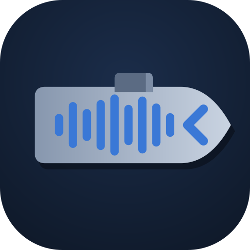
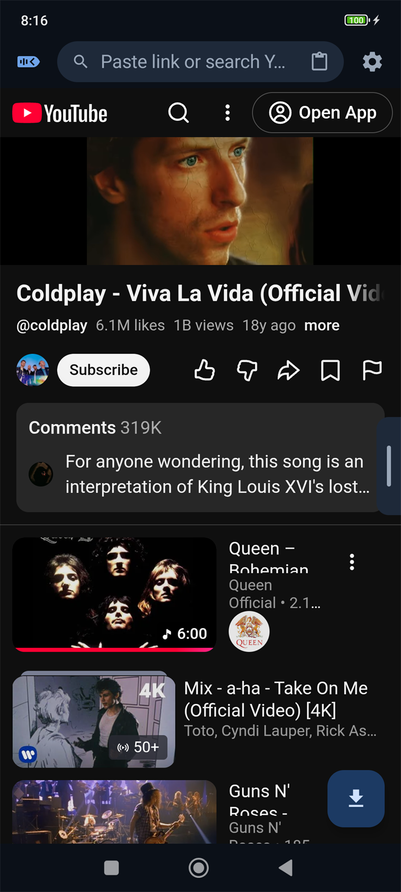
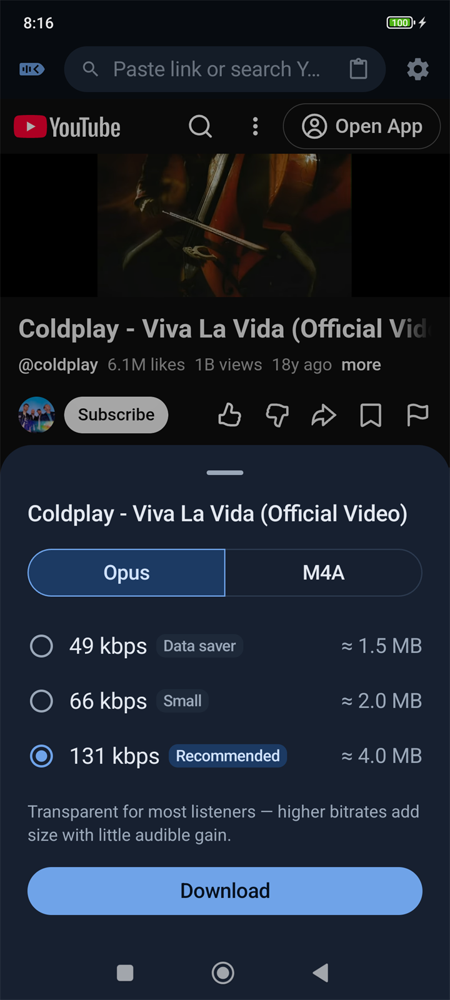
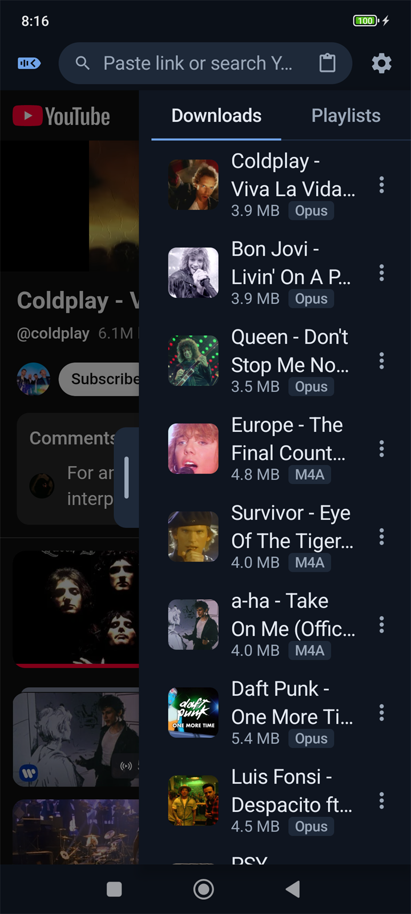
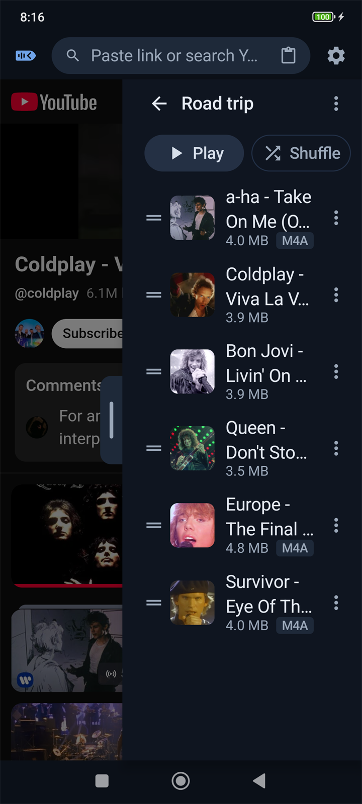
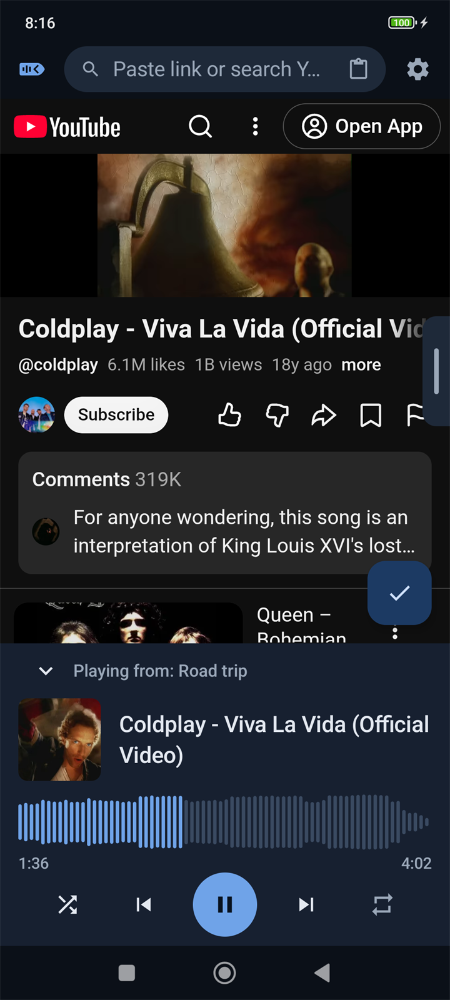
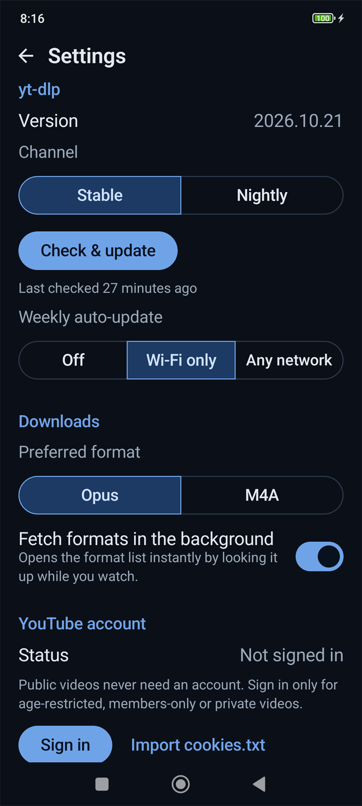

<p align="center">
  
</p>

<h1 align="center">Akagi</h1>

<p align="center">
  <b>A YouTube audio downloader and offline music player for Android.</b><br>
  Browse YouTube, save the audio of any video as Opus or M4A, and listen anywhere: no account, no ads, no tracking.
</p>

<p align="center">
  <a href="../../releases/latest"></a>
  <a href="../../actions/workflows/ci.yml"></a>
  
  
  <a href="LICENSE"></a>
</p>

<p align="center">
  <a href="../../releases/latest"><b>⬇ Download the latest APK</b></a>
  &nbsp;·&nbsp; <a href="#features">Features</a>
  &nbsp;·&nbsp; <a href="#install">Install</a>
  &nbsp;·&nbsp; <a href="#troubleshooting">Troubleshooting</a>
  &nbsp;·&nbsp; <a href="#building-from-source">Build</a>
</p>

<table align="center">
  <tr>
    <td align="center"><br><sub><b>Browse</b> YouTube as usual</sub></td>
    <td align="center"><br><sub><b>Pick a format</b>, or take the recommendation</sub></td>
    <td align="center"><br><sub>Your <b>library</b> in a side panel</sub></td>
  </tr>
  <tr>
    <td align="center"><br><sub><b>Playlists</b> you can reorder</sub></td>
    <td align="center"><br><sub>A <b>player</b> with a waveform seekbar</sub></td>
    <td align="center"><br><sub><b>Settings</b> that keep it working</sub></td>
  </tr>
</table>

## Features

### Download
- **YouTube built in.** Browse and search YouTube inside the app, or paste any YouTube link (share links, Shorts, `youtu.be`).
- **One tap to save.** A download button appears on every video. Choose **Opus** or **M4A** straight from YouTube's own
  audio streams, with no re-encoding; MP3 only as a fallback. Each quality shows its size, and a recommended one is
  preselected. Long-press the button to download at once in your preferred format.
- **Fast format list.** Akagi looks up the formats while you watch, so the list is usually ready when you tap.
- **Background downloads.** Up to three at a time, with progress, Cancel and Retry in the notifications.
- **Cover art included.** Every file carries the video's thumbnail as square cover art, plus its title, so other music
  players show it properly. Files go to `Music/Akagi`.

### Listen
- **Library panel.** Drag the handle on the right edge to open your downloads (newest first) and playlists, at half
  or full width, without leaving the video you're on.
- **Playlists.** Create, rename, reorder by dragging, and add a track to as many playlists as you like.
- **Player.** Shuffle, repeat one or all, and a waveform seekbar drawn when the track was downloaded. Playback keeps
  going in the background with the screen off, with simple lock-screen and notification controls.
- **Considerate audio.** When headphones or earbuds disconnect, Akagi pauses and sets the media volume to 0, so nothing
  blasts from the speaker. A YouTube video playing with sound pauses Akagi, and pressing play in Akagi pauses YouTube.

### Keep working
- **Update yt-dlp in the app.** When YouTube changes something, tap **Check & update** in Settings. Akagi also checks
  once a week (on Wi-Fi by default).
- **Optional sign-in.** Public videos never need an account. Sign in inside the app (or import a `cookies.txt`) to
  download age-restricted, members-only or private videos. By default your account is only used when YouTube asks
  for it.
- **Clear errors.** No connection, age restriction, live streams and region locks each get a plain message with the
  next step, such as Retry or Sign in.

### Privacy
- No analytics, no ads, no trackers, and no Akagi servers. The app talks only to YouTube (and Google's sign-in page,
  if you sign in) and, for yt-dlp updates, to GitHub.
- Your sign-in stays in the app's own browser storage on your phone. yt-dlp gets a temporary copy of the cookies only
  for a download that needs it, and the copy is deleted afterwards.
- Crash reports are never sent anywhere. If Akagi crashes, it offers to share the report, and only you decide where
  it goes.

## Install

1. On your phone, open the [latest release](../../releases/latest) and download `Akagi-vX.Y.Z-arm64-v8a.apk`.
2. Open it and allow installing from your browser when Android asks.
3. Open Akagi. The first start takes a few seconds longer while it unpacks yt-dlp, Python and FFmpeg (about 130 MB).

**Requirements:** Android 10 or newer on a 64-bit (arm64) phone.

**Updating:** install a newer APK the same way. It installs over the old one and keeps your library and playlists.
Each release also lists the APK's SHA-256 checksum (`.sha256`) if you want to verify the download.

## Using Akagi

| To… | Do this |
|---|---|
| Download the video you're watching | Tap the download button, pick a quality, tap **Download** |
| Download in your usual format without the sheet | Long-press the download button |
| Open your library | Drag (or tap) the handle on the right edge |
| Widen or close the library | Drag the handle; or swipe left on Playlists to widen, swipe right on Downloads to narrow or close |
| Play | Tap a track; the whole list, or the playlist you're in, becomes the queue |
| Add to a playlist, or delete | The **⋮** menu on a track |
| Reorder a playlist | Drag a track by its handle |

## Troubleshooting

<details>
<summary><b>"YouTube changed something" or downloads suddenly fail</b></summary>

YouTube changes often. Open Settings and tap **Check & update** to get the newest yt-dlp. If the stable version
doesn't help yet, try the **Nightly** channel.
</details>

<details>
<summary><b>Age-restricted, members-only or private videos</b></summary>

Sign in under Settings → YouTube account. If Google won't let you sign in inside the app, export `cookies.txt` from
a desktop browser where you're signed in to YouTube and import it there. Public videos never need an account.
</details>

<details>
<summary><b>The format list takes a while</b></summary>

Finding the formats of a video takes 10–20 seconds on a typical phone. With "Fetch formats in the background" on
(the default), this happens while you watch, so the list is usually ready by the time you tap.
</details>

<details>
<summary><b>My songs are missing after reinstalling</b></summary>

After an uninstall and reinstall, Akagi doesn't know the songs it saved before. They stay in `Music/Akagi` and play
in other music apps. Downloading one again in Akagi saves a second copy. To keep your library, update by installing
the new APK over the old one instead of uninstalling first.
</details>

<details>
<summary><b>Music stops after a while with the screen off</b></summary>

Akagi plays as a standard media app, which stock Android leaves alone, but some phone makers add their own battery
savers that can still stop it:

- **Xiaomi / Redmi / POCO (HyperOS, MIUI):** Settings → Apps → Akagi → Battery saver → **No restrictions**, and turn
  on **Autostart**. In Recents, long-press Akagi and lock it.
- **Samsung:** Settings → Battery → Background usage limits: make sure Akagi isn't under *Sleeping apps* or
  *Deep sleeping apps*.
- **OnePlus / OPPO / realme:** Settings → Battery → App battery management → Akagi → **Allow background activity**.
- **Huawei / Honor:** Settings → Battery → App launch → Akagi → **Manage manually**, with all three switches on.

More vendor-specific steps are collected at [dontkillmyapp.com](https://dontkillmyapp.com).
</details>

Found a bug? [Open an issue](../../issues) and, if Akagi showed a crash report, attach it.

## Building from source

Requirements: JDK 17+ (21 recommended) and the Android SDK (platform 37, build-tools 36).
On Windows, `tools/setup-toolchain.ps1` installs both into your user profile without admin rights.

```sh
./gradlew assembleDebug                                 # debug APK in app/build/outputs/apk/debug/
./gradlew spotlessCheck lintDebug testDebugUnitTest     # what CI runs on every push
```

The debug build installs next to the release one (`io.github.z0orb.akagi.debug`). Release APKs are built and signed by
GitHub Actions when a `vX.Y.Z` tag is pushed.

<details>
<summary><b>Tech stack</b></summary>

- **UI:** Kotlin, Jetpack Compose (Material 3), a dark-only navy and grey theme
- **Architecture:** single activity, package by feature, ViewModels with one `StateFlow` each, Hilt for dependency
  injection
- **Storage:** Room for the library, playlists and download queue; MediaStore for the audio files
- **Playback:** Media3 (ExoPlayer and MediaSession) in a foreground service
- **Downloading:** [youtubedl-android](https://github.com/yausername/youtubedl-android) running yt-dlp with Python,
  FFmpeg and QuickJS on the device
- **Images:** Coil; **CI/CD:** GitHub Actions
</details>

## Credits and licences

Akagi is free software under the [GNU GPL v3](LICENSE). It bundles or builds on:

| Component | Licence |
|---|---|
| [yt-dlp](https://github.com/yt-dlp/yt-dlp) | Unlicense |
| [youtubedl-android](https://github.com/yausername/youtubedl-android) | GPL-3.0 |
| [FFmpeg](https://ffmpeg.org) | GPL / LGPL |
| [Python](https://www.python.org) | PSF License |
| [QuickJS](https://bellard.org/quickjs/) | MIT |
| [mutagen](https://github.com/quodlibet/mutagen) | GPL-2.0-or-later |
| AndroidX, Media3, Material components, Kotlin, Hilt, Coil, Reorderable | Apache 2.0 |

The full list with licence texts is in the app under Settings → About → Open-source licences.
The app icon is original artwork made for Akagi, named after the aircraft carrier *Akagi*.

## Disclaimer

Akagi is a personal project for downloading content you have the right to download. Respect YouTube's Terms of
Service and creators' copyrights. Akagi is not affiliated with YouTube, Google or TubeMate.
